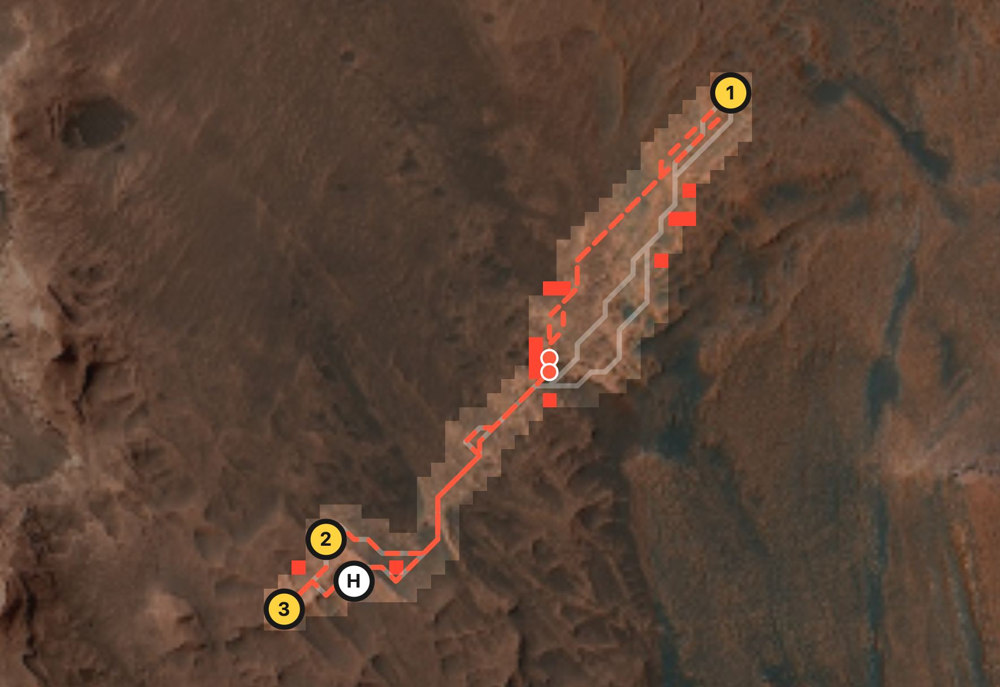
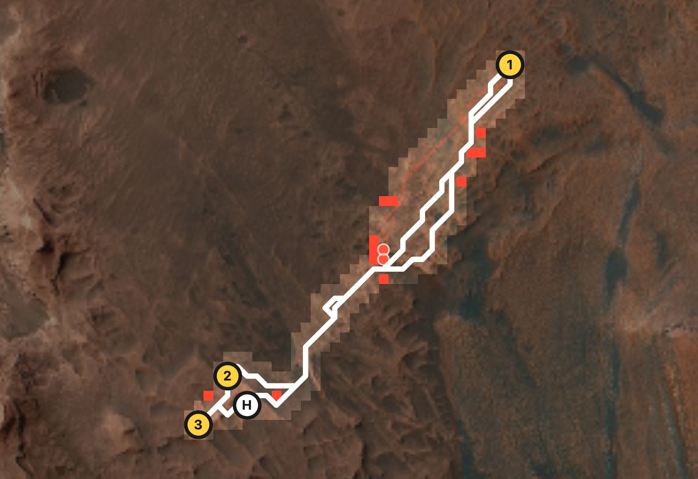
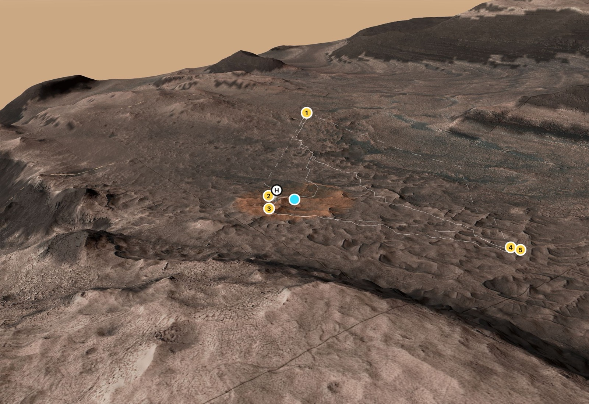
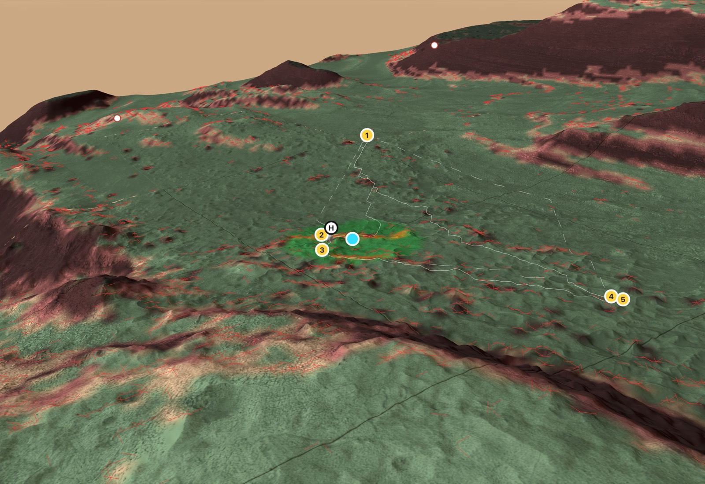
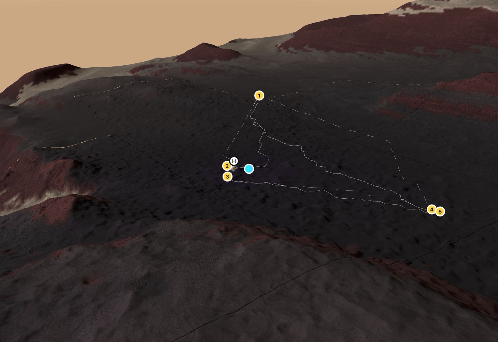
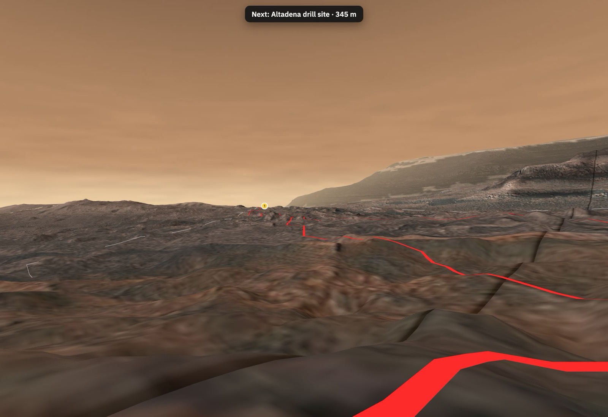

# Mission VESTA

**Plan a safe science walk on Mars from NASA data: scout it with a helicopter first, then walk it and come home.**

NASA Space Apps Challenge 2026 · Chicago · Challenge: *Interplanetary Survival Guide: Martian Map*

**[▶ Open the live site](https://nasa.nicolasrufino.com)** · [Vesta Scout](https://nasa.nicolasrufino.com/scout/) · [Vesta Vision](https://nasa.nicolasrufino.com/scout/?vision) · [How it works](app/HOW-IT-WORKS.md) · [NASA data](docs/DATA.md) · [Pitch](docs/PITCH.md)

| Before scouting | After three helicopter flights |
|---|---|
|  |  |

Runs in a phone or laptop browser. Nothing to install.

## The problem

There is no map of Mars detailed enough to plan one walk. Orbit shows the region but misses the rock field, the soft sand and the short steep step that decide whether a suited astronaut gets through. Earth is 4 to 22 minutes away by radio, so the crew has to know the way home before they leave. Full reasoning: [docs/PRODUCT.md](docs/PRODUCT.md).

## Two products on one map

Both use the same real 2 × 2 km slice of lower Mount Sharp, Gale crater, where Curiosity studied the boxwork ridges in 2025.

### Vesta Scout: the guided mission (`/scout/`)

Four steps, from the habitat console:

1. **Stops.** Pick a science goal (*Groundwater* or *Investigate boxwork*) and the stops to visit on the orbit map.
2. **Route.** The planner finds the cheapest safe route: walking energy per step, walls where the ground is too steep, and the energy needed to get home from every point.
3. **Scout.** Up to three helicopter flights, at most 1 km each, scan the stretches the route depends on. After each landing, the route is planned again around what the flight found.
4. **Walk.** Preview the walk on the scouted map and review it at the end.

### Vesta Vision: the map (`/scout/?vision`)

The same slice in 3D at true scale: HiRISE imagery on the real relief, five views (Imagery, Hazards, Energy home, Science, Radiation), a fly-through of the route, and an eye-level walk with NASA's Z-2 suit model for scale.

| Imagery | Hazards | Energy home | Eye level |
|---|---|---|---|
|  |  |  |  |

## Results, each with the file it comes from

- **Terrain accuracy:** our 1 m terrain matches Curiosity's elevations at 148 drive waypoints to 0.12 m RMSE (`data/worlds/gale/validation.json`, made by `data/pipeline/check_accuracy.py`).
- **Scouting on Gale:** three flights take the stored hazard cells on the five-stop route from 6 to 0, for 1.46% more walking energy (621.4 → 630.5 kJ). This is a simulation, and the file says so ([ml/pitch_metrics/PITCH_NUMBERS.md](ml/pitch_metrics/PITCH_NUMBERS.md), `ml/exports/pitch_metrics.json`).
- **Ground-photo classifier** (experiment, off in the demo): 93.1% accuracy on 159 Curiosity patches and 48.2% on 197 Perseverance patches (`ml/exports/terrain_cls.json`). The drop on Perseverance is why it stays off.
- **Real vs simulated:** terrain, slope, imagery, Curiosity's stops and the energy formula are real. The helicopter flights, the astronaut and the stop photos are simulated. Full list: [How it works §14](app/HOW-IT-WORKS.md).

## NASA data

Every source, what it is and how we use it, with links: [docs/DATA.md](docs/DATA.md).

| Data | Mission or source | Used for |
|---|---|---|
| Gale merged terrain model (1 m) and image mosaic (25 cm) | MRO HiRISE, via USGS Astrogeology | Terrain, slope, walls, imagery, rocks |
| Mars Trek | NASA JPL | Choosing the slice |
| THEMIS thermal inertia | Mars Odyssey (NASA PDS) | Sand and dust |
| CRISM | Mars Reconnaissance Orbiter (NASA PDS) | Water-related minerals for science targets |
| Curiosity RAD and REMS | Mars Science Laboratory (NASA PDS) | Radiation dose rate and weather |
| Curiosity ChemCam, APXS and DAN | Mars Science Laboratory (NASA PDS) | Chemistry and hydrogen at the stops |
| Curiosity raw images and traverse | NASA JPL | Stop photos; terrain validation |
| Perseverance raw images | Mars 2020 | Classifier test set |
| AI4Mars | NASA JPL | Classifier training labels |
| SkyFall Mission Information Package | NASA | Helicopter flight profile |
| Z-2 suit, Ingenuity and habitat 3D models | NASA 3D Resources, NASA/JPL-Caltech | The astronaut, helicopter and habitat ([credits](app/src/models/README.md)) |

NASA Worldview, also on the challenge's resource list, has no Mars data, so we don't use it.

## Run it locally

```bash
cd app && npm install
npm run dev          # http://localhost:5173 is the home page; /scout/ is the app
npm test             # unit tests
npm run build        # production build in app/dist/
```

Browser tests: `npx playwright install chromium && npm run test:browser`. To rebuild the Gale world from the USGS files, see "Rebuild" in [docs/DATA.md](docs/DATA.md). To build the synthetic test world (standard library only): `python3 data/pipeline/make_world.py`.

## What's in the repo

| Folder | What lives there |
|---|---|
| `app/` | The web app (three.js + Vite): home page, Vesta Scout, Vesta Vision |
| `data/` | The NASA data pipeline and the world files the app loads |
| `ml/` | Rock detection review, ground-photo classifier, measured pitch numbers |
| `agent/` | CAPCOM assistant: offline experiment, not in the demo |
| `docs/` | Product, data, research, decisions and pitch. Start at [docs/README.md](docs/README.md) |

Working on the code: `AGENTS.md` has the team rules, and each folder has its own `AGENTS.md`.

## Limits

- The helicopter flights, the astronaut and the stop photos are simulated.
- The classifier and the hidden-rock map are experiments, off by default.
- Not yet tested on a real phone over HTTPS.

What is still missing is listed in [docs/DECISIONS.md](docs/DECISIONS.md).

## Team

| Who | Role |
|---|---|
| **Nicolas** (lead) | App and 3D: Vesta Scout, Vesta Vision, the home page |
| **Jules** | Machine learning: rock detection, ground classifier |
| **Luca** | Data: the Gale slice, its terrain layers and crossings, the eight NASA data types |
| **Galsan** | Systems and integration |

## Credits and license

Code: [MIT](LICENSE). NASA imagery, data and 3D models belong to their sources and are credited where they are used; see [docs/DATA.md](docs/DATA.md) and [app/src/models/README.md](app/src/models/README.md). Fonts: Rethink Sans and IBM Plex Sans, under the SIL Open Font License. This project uses NASA data and models; it is not endorsed by NASA.
